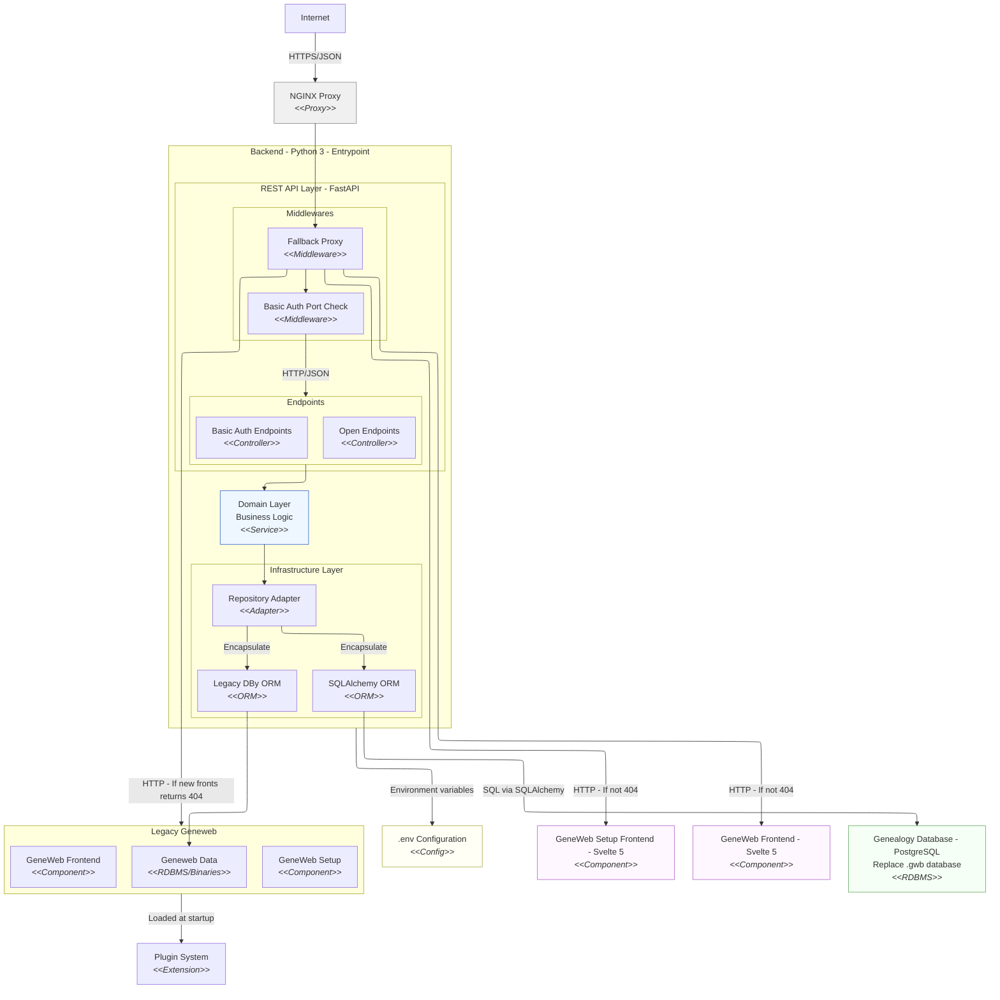

# New Python-Based Architecture Overview

[UML Version Here](https://editor.plantuml.com/uml/XLLDazf64BtFh-ZQYvq3zfRjNBPSb148JCA7WjOcARo7GMh4r8gHQcO4LbB-x-cPaLZ1PXqEW6RUwtxzgK_QS6MgGywCC3d212MUS0k78aKbnT-OmX6L5eK4hfAzC9YOIY5Z-b78aYj-WAGub8L4QM9JamL522wp73kG57Uyoisua6R13mXJQL1rxa-AbskHcZsykxrbRBEOJ1T_GgIAx_K3S0t--UD7TzBlCrRov95d23S1_K6PGW-Yskn9vNlw6qgZwh8GqjnOTZ0O_Wx_CA3FcRSAutiOH5EOyHeLSSPS6tfs17lkyHUSkKZJ74zSeNQm-Rg3if_DcEVvbk0TwUE0T3ynIVm58-1Q932eAFIeK0Q6UqmU7xpgbuW_daiBPUhYzSB2nIYwbjPnT0OxFoj2awSXrKOLUOxgMkAoH7d5MVw4uzNzOEvdCoeEN4YVvMyogBIGg3NCYamapjHiEPaEoLQCwYYIDan_sjliANwK3pdk35KuNCNJ-3vS3CF_0YcHxGb5nMENjPxAdQBggigrhjVYyjGns4dNPeLbeOKfL0s3b9VKgasYeYK9ROuw4M_YFsQ3FDdZeORbQkupj9eJbhwxk1bcFAbX53pXPk5aqCMUmSxRERQgx5dAJsuRGqtoAVqREyfh6kKOJLN2M56n_AJ4HymDmg--F-tvPEr1jgJDC9EMiuN_uLxHdeQpYRVPAJTjlCE_ccm_S-2iJjRZAuiNMAUq0SOl0UqA6t736vnjrjKecCTl0o6v4gWRiFLraKR2DXVnymlAQaf6jrnJSDODpukiTexS6RLeeKsca1hYcmHwfbRAUOBm9ZjjeUMwH8o2LfDDsIRAgupc9AwrmODJ7Ss-qDQp4ORVAJTs1LiaRMknuuc1cpSeZzuBpU5EP9NYXa3D1lZgvvFEBUiLASdTjMPk-Keqq4kBa-pr_NQzWy_tzr7yzhTukM1-txRtuu0nMcCzDuLzMaoCqN9gRzsoyMnFjb3AMF_S7luINazt80i37su__F8CvFll9MJZgccUBWfFiBCMDBrtQBgbzYJcL5cAtH6isHJEeHqTnlm0zTsStj5sItYfAyeGCdlIEgGYtG4L4uw2mzEKdzdjz5vQQ4zRAxPrMAET7jl2tj4Mv2czOBa1_nOkcNjLkQH-TKQFWe8xK7F3aTgMRtFKZ7sYIR5lx7y1)

## Purpose
Modernize GeneWeb by replacing monolithic OCaml binaries with a service-oriented Python stack (FastAPI + SQLAlchemy) while preserving feature parity (gw / gwsetup) and enabling incremental migration of legacy operations (conversion, export, consanguinity calculation, utilities) into maintained, testable modules and API endpoints.

## High-Level Goals
- Single unified HTTP API for both public (read) and restricted (admin/maintenance) operations.
- Database-backed persistence (PostgreSQL) replacing opaque array-based .gwb storage, with a compatibility import/export layer.
- Pluggable data processing tasks (former binaries) exposed via REST or background jobs.
- Clear separation of concerns: Presentation (Svelte frontends) / API layer / Domain services / Data access.
- Extensibility via a controlled plugin system without compromising core integrity or security.

## Component Breakdown
### Frontends
- Open Svelte frontend (`gw` replacement): public browsing & search.
- Config/Admin Svelte frontend (`gwsetup` replacement): maintenance, imports, index rebuilds, permission management.
Both communicate exclusively through the HTTP API (no direct DB or filesystem access).

### API Layer (FastAPI)
- `API1` (Open endpoints): read-only or low-risk operations (search persons, view trees, events, titles, relationships, media, exports of public data).
- `API2` (Restricted endpoints): mutation, administrative tasks, importing GEDCOM, generating exports, running compute-heavy tools (consanguinity, diff, database maintenance). Optional IP filtering + token/JWT auth.
- Background task integration (FastAPI + worker, e.g. Celery / RQ) planned for long-running jobs (imports, recomputation) to avoid blocking requests.

### Data Processing Module (`DP`)
Encapsulates migrated logic of legacy binaries:
- `consang`: consanguinity calculations.
- `ged2gwb` / `gwb2ged`: bidirectional GEDCOM conversion (internally now DB <-> GEDCOM, with optional intermediate in-memory .gwb adapter for backward compatibility).
- `gwu`: update / maintenance utilities (index rebuild, caches, cleanup) turned into idempotent service functions.
- Future: diffing (gwdiff), export variants (gwexport), lineage graphing.

### DB Connector (`DBS`)
- SQLAlchemy ORM + repository/service abstractions.
- Centralizes session lifecycle, transactions, and retry/backoff strategies.
- Provides a boundary to implement future multi-tenancy (schema-per-base or row-level scoping) and soft deletes/auditing.

### PostgreSQL Store (`DBP`)
- Canonical persisted state.
- Transitional support: import existing `.gwb` data into normalized schema (see `database_schemas/`).
- Potential event sourcing or change audit tables added later for provenance.

### Configuration (`ENV`)
- `.env` or environment variables control DB URL, plugin directory, security toggles, worker backend, rate limits, logging level.
- Configuration validated at startup (e.g. Pydantic Settings) to fail fast.

### Plugins (`PLUG`)
- Discovery via entry points or directory scanning.
- Strict contract: register routes (namespaced), or provide data processors; no direct DB schema mutations without migration registration.
- Isolation guidelines: minimal shared state, dependency injection for services, input/output validation.

## Request Lifecycle (Typical Read)
1. Frontend issues HTTP request to open endpoint.
2. FastAPI router validates params (Pydantic models).
3. Service layer composes repositories (SQLAlchemy queries) / applies domain logic.
4. Response serialized (JSON) with hypermedia/style conventions (e.g. stable IDs, pagination, ETag for caching).
5. Optional caching layer (future) short-circuits hot reads.

## Legacy Binary Migration Strategy
| Legacy Binary | New Form | Notes |
|---------------|----------|-------|
| gw / gwc (read) | API1 endpoints | Aggregated under resource controllers |
| gwsetup | API2 endpoints + Admin UI | IP restriction applied |
| ged2gwb | Import service + background task | Streams GEDCOM -> staging -> normalized tables |
| gwb2ged | Export service | Query -> assemble GEDCOM with consistent ordering |
| gwu | Maintenance endpoints | Idempotent operations (rebuild indexes, recalc metrics) |
| consang | Analysis service | Precomputes metrics, stores derived stats tables |
| gwexport | Export profiles | Could map to templated serializers |
| gwdiff | Comparison service | Planned: structural diff between versions / bases |

## Data Layer Strategy
- Start with pragmatic denormalized fields (textual place, source, notes) to accelerate migration; refactor into dedicated tables iteratively.
- Use integer-coded enums initially (documented in `database_schemas/README.md`) then migrate to FK lookup tables once stabilized.
- Consistency enforcement: database constraints + service invariant checks (e.g. no circular parentage, chronological sanity for life events).

## Security & Access Control
- Split open vs restricted routers
- Mandatory IP allowlist for sensitive operations (import/export, system maintenance)

## Related Documentation
- [Legacy storage format](../docs/geneweb/architecture/storage-format.md)
- [Enumerations & schema](./database_schemas/README.md)
- [Consanguinity algorithm deep-dive](../docs/geneweb/algorithms/consanguinity.md)

## Change Log
- 2025-09-12: Added architecture explanation sections below diagram.