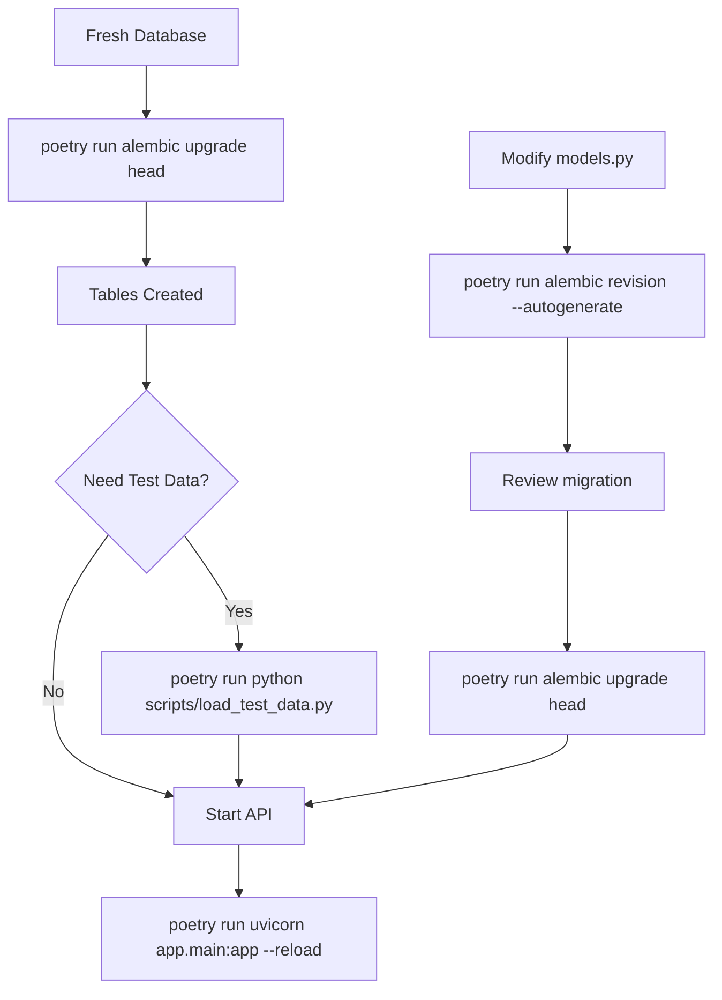

# 🚀 Quick Start Guide - GeneWeb Backend

This guide covers the complete database setup workflow for the GeneWeb backend.

## 📋 Prerequisites

- PostgreSQL 13+ running
- Python 3.13+
- Poetry 1.8+
- Database credentials in `.env` file

## 🎯 Quick Start (New Database)

```bash
cd backend

# 1. Install dependencies
poetry install

# 2. Apply migrations (creates all tables)
poetry run alembic upgrade head

# 3. Load test data (optional)
poetry run python scripts/load_test_data.py

# 4. Start the API
poetry run uvicorn app.main:app --reload
```

## 🔧 Development Scripts

### Setup Database (Development Only)

For rapid development iteration, you can use the Python scripts:

```bash
# Create/recreate all tables from SQLAlchemy models
poetry run python scripts/setup_database.py --drop-all

# Load sample genealogical data
poetry run python scripts/load_test_data.py
```

**⚠️ Warning:** These scripts are for development only. Use Alembic migrations for production.

### Teardown Database

```bash
# Safely remove all tables (with double confirmation)
poetry run python scripts/teardown_database.py
```

## 📊 Alembic Migrations (Production)

### Create a New Migration

```bash
# After modifying models.py, generate migration
poetry run alembic revision --autogenerate -m "Description of changes"

# Review the generated file in alembic/versions/
# Edit if necessary, then apply:
poetry run alembic upgrade head
```

### Migration Commands

```bash
# Show current migration version
poetry run alembic current

# Show migration history
poetry run alembic history

# Upgrade to latest
poetry run alembic upgrade head

# Upgrade one step
poetry run alembic upgrade +1

# Downgrade one step
poetry run alembic downgrade -1

# Downgrade to base (removes all tables)
poetry run alembic downgrade base
```

## 🧪 Testing the Setup

```bash
# Run all tests
poetry run pytest

# Run specific test file
poetry run pytest tests/test_DBConnector.py

# Run with coverage
poetry run pytest --cov=app
```

## 📁 Database Schema

The database includes **10 main tables**:

1. **geneweb_database** - Root table for multi-database support
2. **individual** - People in genealogical tree
3. **family** - Family units (marriages)
4. **event** - General events
5. **child** - Links individuals to families as children
6. **individual_event** - Events specific to individuals (birth, death, etc.)
7. **family_event** - Events specific to families (marriage, divorce)
8. **relationship** - Relationships between individuals
9. **title** - Nobility titles and ranks
10. **witness** - Witnesses to events

Plus **alembic_version** for migration tracking.

## 🔍 Verification

After setup, verify everything works:

```bash
# Check database connection
poetry run python test_connection.py

# List all tables
poetry run python scripts/setup_database.py

# Check migration status
poetry run alembic current
```

Expected output:
```
✅ Database connection successful
📊 Tables in database (11):
   ✓ alembic_version
   ✓ child
   ✓ event
   ✓ family
   ✓ family_event
   ✓ geneweb_database
   ✓ individual
   ✓ individual_event
   ✓ relationship
   ✓ title
   ✓ witness

e057f27a4cca (head)
```

## 📚 Additional Documentation

- **[scripts/README.md](scripts/README.md)** - Detailed documentation for development scripts
- **[database_schemas/README.md](../database_schemas/README.md)** - SQL schema reference

## 🐛 Troubleshooting

### "ModuleNotFoundError: No module named 'sqlalchemy'"

**Solution:** Always use `poetry run` to execute commands within the Poetry environment.

```bash
# ❌ Wrong
python scripts/setup_database.py

# ✅ Correct
poetry run python scripts/setup_database.py
```

### "Database connection failed"

**Check:**
1. PostgreSQL is running: `sudo systemctl status postgresql`
2. `.env` file exists with correct credentials
3. Database exists (replace user/password with values from `.env`):
   ```bash
   PGPASSWORD=password psql -h localhost -U user -c "SELECT datname FROM pg_database;"
   ```

### "FAILED: alembic/versions/xxx.py ... FileNotFoundError"

**Solution:** Create the versions directory:
```bash
mkdir -p alembic/versions
```

### "Detected added table 'X' but migration is empty"

**Cause:** Tables already exist in database.

**Solution:** 
1. Use `teardown_database.py` to clean database
2. Regenerate migration with `alembic revision --autogenerate`

## 🎓 Workflow Summary



---

**Last Updated:** October 6, 2025  
**Migration Version:** `e057f27a4cca` - Initial database schema with all tables
