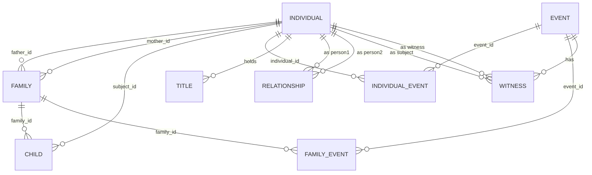

# GeneWeb New Database Schema

## Overview
This directory defines a proposed relational schema for a new GeneWeb backend. It normalizes persons (individual), family units, events, titles, relationships between individuals, and witness roles attached to events.

Core tables:
- `individual`: Biographical core entity (names, birth/baptism/death/burial metadata, status flags, access control & gender)
- `family`: Parental couple (optionally same-sex) linking mother/father
- `child`: Association table linking families to their children
- `relationship`: Generic interpersonal relationship (adoption, recognition, godparenting, foster, etc.) between two individuals
- `event`: Arbitrary dated place-associated event (custom extensible `event_name`)
- `individual_event`: Association table linking individuals to their events (many-to-many)
- `family_event`: Association table linking families to their events (many-to-many)
- `title`: Nobility / honorific titles held by an individual over time
- `witness`: Participation of a third-party individual in an event with an assigned role

## Entity-Relationship Diagram
Mermaid visual graph of tables and their foreign-key connections:

Legend:
- Crow foot `o{` = zero or more; `||` = exactly one; `o|` would mean optional exactly one.
- Self references appear via multiple roles pointing back to `individual`.

## Table Notes & Cardinalities
- A `family` row optionally references up to two parent individuals (`father_id`, `mother_id`). Children are linked to families through the `child` association table, allowing for complex family structures.
- `child` table manages the many-to-many relationship between families and individuals, supporting cases where an individual may be associated with multiple family units.
- `relationship` expresses pairwise links with a typed semantic meaning (`relationship_type_id`). Direction is significant only by convention; both `person1_id` and `person2_id` are required.
- `event` models life events (births, deaths, marriages, migrations, occupations, religious events, etc.) as independent entities. Events are linked to individuals and families through association tables.
- `individual_event` creates many-to-many relationships between individuals and events, allowing one person to participate in multiple events and one event to involve multiple people.
- `family_event` creates many-to-many relationships between families and events (e.g., marriages, divorces, family relocations).
- `witness` connects an `event` to third-party participants; one event may have many witnesses with distinct roles.
- `title` rows capture temporal intervals; overlapping entries possible (multiple contemporaneous titles).

## Enumerated/Domain Value Index
The schema stores several categorical attributes as integer codes. Below are their current dictionaries.

### gender_id
| id  | label   |
| --- | ------- |
| 0   | Unknown |
| 1   | Male    |
| 2   | Female  |

### access_type_id
| id  | label     |
| --- | --------- |
| 0   | If titles |
| 1   | Public    |
| 2   | Public    |

NOTE: Values 1 and 2 are identical; confirm whether 2 should instead represent a more restrictive classification (e.g. "Private" or "Restricted").

### death_status_id
| id  | label             |
| --- | ----------------- |
| 0   | Unknown           |
| 1   | Alive             |
| 2   | Dead              |
| 3   | Dead as an infant |
| 4   | May be dead       |

### death_kind
| id  | label       |
| --- | ----------- |
| 0   | Killed      |
| 1   | Murdered    |
| 2   | Executed    |
| 3   | Dissapeared |
| 4   | Unspecified |

(Spelling: consider `Disappeared`.)

### date_range (date qualifier semantics)
| id  | label         |
| --- | ------------- |
| 0   | exact         |
| 1   | about         |
| 2   | possibly      |
| 3   | before        |
| 4   | after         |
| 5   | ...or...      |
| 6   | ...between... |

### role_id (witness roles)
| id  | label            |
| --- | ---------------- |
| 0   | Witness          |
| 1   | Informant        |
| 2   | Present          |
| 3   | Cited            |
| 4   | Civil registrar  |
| 5   | Parish registrar |
| 6   | Other            |

### relationship_type_id
| id  | label            |
| --- | ---------------- |
| 0   | Not specified    |
| 1   | Adoptive parents |
| 2   | Recognized by    |
| 3   | May be parents   |
| 4   | Godparents       |
| 5   | Foster parents   |

## Suggested Normalization Enhancements
Future evolution could:
- Introduce lookup tables (`gender`, `death_status`, etc.) with FK constraints instead of inline integers for referential integrity and self-documentation.
- Add an associative `family_child` linking children to multiple parent-couple unions (supports complex genealogies, remarriages, blended families) instead of single `family_id` on `individual`.
- Factor place names into a `place` table with hierarchical geospatial normalization.
- Replace free-form `event_name` with an `event_type` reference table to unify semantics and allow localization.